  

  <a href="https://madmaxcoder2612.github.io/portfolio/"><b>Portfolio</b></a> ·
  <a href="https://www.linkedin.com/in/abhishek-vijay-potekar-027126193/"><b>LinkedIn</b></a> ·
  <a href="mailto:ab.potekar@gmail.com"><b>Email</b></a>

Hardware, IoT and cloud background, now building towards **functional safety for robots and embedded systems**. My best projects are pinned below. Each one says what it does not prove. Open source: a small tutorial article of mine was merged into the LoginRadius engineering portal in 2020 ([PR #414](https://github.com/LoginRadius/engineering-portal/pull/414)).

  

