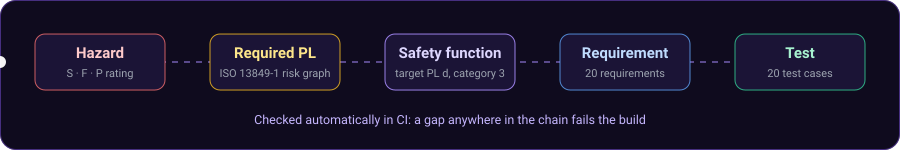

  

  <a href="https://madmaxcoder2612.github.io/portfolio/"><b>Portfolio</b></a> ·
  <a href="https://www.linkedin.com/in/abhishek-vijay-potekar-027126193/"><b>LinkedIn</b></a> ·
  <a href="mailto:ab.potekar@gmail.com"><b>Email</b></a>

Hardware, IoT and cloud background (B.Tech ECE, LPU), now building towards **functional safety for robots and embedded systems**. Every project below is a learning project and says what it does not prove.

  

### Safety and robotics

| | |
|---|---|
| 🦾 **[cobot-hara-safety-concept](https://github.com/Madmaxcoder2612/cobot-hara-safety-concept)** | Hazard analysis and safety concept for a cobot cell, with traceability check, stopping distance and achieved PL |
| 🔧 **[ra0e3-safety-monitor](https://github.com/Madmaxcoder2612/ra0e3-safety-monitor)** | Safety mechanisms in C on a Cortex-M23 board (not certified) |
| 🧭 **[mems-imu-calibration](https://github.com/Madmaxcoder2612/mems-imu-calibration)** | IMU calibration and five orientation filters in MATLAB |

### Quantum computing

| | |
|---|---|
| ⚛️ **[qiskit-fall-fest-2026-quantum-thinkers](https://github.com/Madmaxcoder2612/qiskit-fall-fest-2026-quantum-thinkers)** | GHZ states on an IBM Heron simulator and real hardware |
| 🔬 **[qiskit-bell-ghz-grover](https://github.com/Madmaxcoder2612/qiskit-bell-ghz-grover)** · **[qiskit-teleportation](https://github.com/Madmaxcoder2612/qiskit-teleportation)** | Textbook circuits with tests and noise |

Stuttgart, Germany · one repo per project, with a README, tests, CI and written-down limitations
